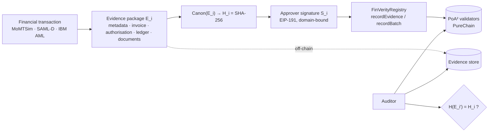

# FinVerity · PureChain

**Continuously verifiable financial audit evidence on a zero-gas PoA² blockchain: framework, measurements and paper sources.**

FinVerity anchors financial audit evidence to the [PureChain](https://purechainnode.com) PoA² blockchain without putting
the evidence on-chain. Every transaction gets a synthetic audit-evidence package (invoice, authorisation, ledger entry,
supporting documents). The package is canonicalised, hashed with SHA-256 and signed by an approver, and only the
32-byte commitment is recorded by a smart contract. An auditor can later re-hash the off-chain evidence and prove that
nothing has changed, or that something has.

This repository contains everything needed to re-run the study: the contract, the simulation framework, the five
infrastructures it was benchmarked on, all 776 trial summaries, the analysis pipeline and the LaTeX sources of the
results report.

---

## What was measured

| | PoA² (FinVerity) | Besu QBFT | PostgreSQL | Ethereum PoS |
|---|---:|---:|---:|---:|
| Sustained capacity, per-record commits (records/s) | **187** | 57 | 1,378 | ≈ 15 |
| Median inclusion latency @ 50 records/s | 1.56 s | 1.28 s | < 5 ms | 213 s |
| Finality (backend rule) @ 50 records/s | 7.55 s | 1.28 s | durable commit | 1,103 s |
| Fee per record | **$0** | $0 | – | $2.30 |
| Measured dynamic energy per record | **0.050 J** | 0.302 J | 0.008 J | 0.171 J |
| Throughput at 10 validators (200 records/s offered) | **175** | liveness lost | – | – |
| Insider rewrites / backdating stopped | **100 %** | 100 % | 0 % | 100 % |

- **Integrity:** 143,000 controlled modifications of off-chain evidence (amounts, dates, vendors, approvers, documents,
  ledger entries, single bits, whole-record substitution) were all detected, with **0 false positives** over 26,000
  benign re-serialisations, on all three datasets.
- **Robustness:** results are statistically indistinguishable across the three transaction datasets for PoA²
  (Kruskal–Wallis p ≥ 0.15). Commit latency does not depend on evidence size (0–5 MB) or complexity.
- **Batching:** Merkle-batched commitments cut on-chain gas per record from 153,376 to about 2,400 (k = 100).

The PoA² column comes from a four-signer PoA testbed calibrated against live PureChain measurements (block packing
identical; 6-confirmation finality within 3.8 %), because the public PureChain RPC stopped producing blocks during the
campaign. Live-network measurements, the calibration and the observed fork behaviour are reported separately in the
paper (`paper/main.pdf`, Sections 1.11 and 2.1).

---

## How it works



| Step | Where |
|---|---|
| Workload normalisation (three datasets → one schema) | `finverity/datasets.py` |
| Evidence generation, levels L1–L4, document sizes | `finverity/evidence.py` |
| RFC 8785 canonicalisation and SHA-256 commitment | `finverity/canonical.py` |
| Registry contract (write-once records, Merkle batches, on-chain verification) | `contracts/FinVerityRegistry.sol` |
| Pipelined submission, fork-aware block watcher, k-confirmation finality | `finverity/backends/evm.py` |
| Database baseline with identical authorisation checks | `finverity/backends/database.py` |
| Tamper-detection and insider-attack experiments | `finverity/tamper.py`, `finverity/insider.py` |
| Resource and energy metering | `finverity/resources.py` |

---

## Repository map

```
contracts/          FinVerityRegistry.sol (solc 0.8.19, EVM paris)
finverity/          simulation framework (evidence, commitment, backends, load generator, metering)
experiments/        experiment matrix E1–E9 (plan.py) and the CLI (run.py)
infra/              Docker launchers: PoA² testbed, Besu QBFT, Ethereum PoS devnet, PostgreSQL
analysis/           statistics, figures and the report builder
scripts/get_data.py dataset download with checksum verification
tests/              unit tests (canonicalisation, evidence, signatures, Merkle proofs, tampering)
results/raw/        one folder per trial: summary.json, verify/tamper/insider parquet, blocks.csv
results/tables/     aggregated tables (CSV and LaTeX)
paper/              LaTeX sources, generated tables, figures and the compiled report (main.pdf)
new figures/        publication figures (PDF and 300 dpi PNG)
```

---

## Reproducing the study

### 1. Environment

Python 3.13, Docker (Desktop) with at least 12 CPUs and 16 GB assigned, and optionally a LaTeX distribution for the report.

```bash
python -m venv .venv
# Windows: .venv\Scripts\activate    Linux/macOS: source .venv/bin/activate
pip install -r requirements.txt
pip install --no-deps purechainlib==2.1.7 web3==6.20.4
pytest -q                      # 18 tests
```

`purechainlib` and `web3` are installed without dependencies because the SDK's optional audit tooling pulls in a
native package that does not build on Python 3.13; the SDK itself works without it. `requirements.lock.txt` pins the
exact versions used for the published results.

Create `.env` (never commit it):

```
PURECHAIN_RPC=https://purechainnode.com:8547
PURECHAIN_CHAIN_ID=900520900520
PURECHAIN_PRIVATE_KEY=<hex key; PureChain has zero gas, the account needs no funds>
```

Role accounts (16 submitters, 24 approvers) are derived deterministically from this key.

### 2. Data

```bash
python scripts/get_data.py
python -c "from finverity import datasets as d; [d.preprocess(s) for s in d.SOURCES]"
```

| Dataset | Rows | Source | License |
|---|---:|---|---|
| MoMTSim (primary) | 4,225,958 | Mendeley Data, doi:10.17632/zhj366m53p.2 | CC BY 4.0 |
| SAML-D | 9,504,852 | Kaggle `berkanoztas/synthetic-transaction-monitoring-dataset-aml` | see source |
| IBM AML (HI-Small) | 5,078,345 | Kaggle `ealtman2019/ibm-transactions-for-anti-money-laundering-aml` | see source |

Fraud and laundering labels are discarded; the datasets are used only as transaction workloads.

### 3. Run

```bash
python -m experiments.run probe                                    # live PureChain facts (validators, gas, RTT)
python -m experiments.run trial --backend poa2_local --n 1000 --rate 50
python -m experiments.run campaign --scale quick                   # smoke test of every experiment
python -m experiments.run campaign --only E1 E2 --backends poa2_local besu db_postgres
```

Backends: `purechain` (live network), `poa2_local`, `besu`, `db_postgres`, `ethpos`. The runner starts the required
Docker network, stops every other local network so it cannot compete for CPU, and skips trials that already have a
`summary.json`, so a campaign can be interrupted and resumed. The complete campaign (E1–E9) takes about 36 hours on
the reference machine (Intel Core i5-12400F, 32 GB RAM).

| ID | Experiment |
|---|---|
| E1 | Workloads W1–W5: 1k to 100k records, 10 KB to 1 MB evidence |
| E2 | Offered load 10–400 records/s and unthrottled |
| E3 | Evidence size: none, 10 KB, 100 KB, 1 MB, 5 MB |
| E4 | Evidence complexity L1–L4 |
| E5 | Validator count 4 / 7 / 10 (1 CPU per validator) |
| E6 | Tamper detection: 11 malicious + 2 benign transformations |
| E7 | Cross-dataset replication on SAML-D and IBM AML |
| E8 | Privileged-insider attacks (rewrite, backdate) |
| E9 | Merkle-batched commitments, k = 1…100 |

### 4. Analyse and rebuild the report

```bash
python -m analysis.stats       # aggregate tables, significance tests → results/tables/
python -m analysis.figures     # figures → results/figures/
python -m analysis.report      # tables + figures + macros → paper/main.pdf and paper/finverity_overleaf.zip
```

Every number in the report is regenerated from `results/raw`. The per-record measurements (`items.parquet`, 1.5 GB)
are attached to the repository's GitHub release. Download and extract them into `results/raw/` to recompute
per-record statistics such as latency distributions.

---

## Measurement notes

- **Latency** is measured per record from its arrival to the first observation of the canonical block containing it.
  A block watcher records every block version and walks back along parent hashes, so short forks are captured.
- **Finality rules:** QBFT, inclusion; PoA², 6 confirmations (the smallest depth above every fork observed on the
  live network); Ethereum PoS, the finalized checkpoint; PostgreSQL, durable commit.
- **Energy** is reported two ways: attributed node energy over the processing window, and measured dynamic CPU energy
  of the client and local containers. Remote PureChain validators cannot be metered.
- **Fees** are charged only on the Ethereum PoS configuration (5 gwei, 3,000 USD/ETH reference prices).
- Trials excluded for infrastructure faults are listed with reasons in `results/_excluded/EXCLUSIONS.jsonl`.

## Citation

See `CITATION.cff`.

## License

Code: MIT (see `LICENSE`). The datasets are not redistributed here and remain under their original licenses.
